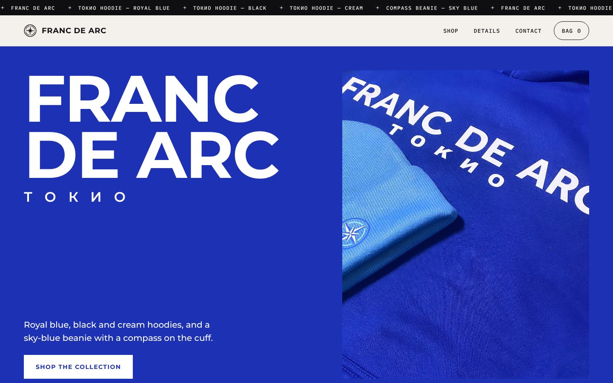

# FRANC DE ARC — website

Storefront for FRANC DE ARC: the ТОКИО Hoodie in royal blue, black and cream, and the Compass Beanie in sky blue.



It's a static site: plain HTML, CSS and JavaScript, with no build step and no dependencies.

## What's in it

- **Home page:** hero, collection grid (hover over a hoodie to see the back), the "Follow the compass" details section and a contact footer.
- **Product pages** at `#/product/<id>` (for example `#/product/hoodie-black`) with photos, colour swatches, a size picker and an "Add to bag" button.
- **Bag** with quantities and a subtotal. It's saved in the visitor's browser, so it survives a reload.
- **Self-hosted fonts** (Montserrat and IBM Plex Mono), so the site makes no requests to Google Fonts.

## Files

| Path | What it is |
| --- | --- |
| `index.html` | The page: header, hero, sections, product view and footer |
| `css/styles.css` | All styles. Colours and fonts are at the top |
| `js/store.js` | Products, prices, sizes, the bag, and switching between pages |
| `images/` | Product and lifestyle photos |
| `fonts/` | Font files and their licences (SIL Open Font License 1.1) |
| `favicon.svg` | Compass mark on royal blue |

## Before you go live

These still show as placeholders on the site:

- **Prices:** set `prices` in the `CONFIG` block at the top of `js/store.js`, for example `{ hoodie: 65, beanie: 25 }`. You can change `currency` in the same place.
- **Sizes:** `hoodieSizes` in the same block. It's currently S, M, L and XL.
- **Email and Instagram:** in the footer of `index.html`.
- **Fabric and care:** one line in the product view in `index.html`, shared by every product. To give each product its own line, add it to that product's `details` list in `js/store.js` instead.
- **Checkout:** the bag doesn't take payments. Set `checkoutUrl` in `CONFIG` to send shoppers to a checkout page (such as Shopify or a Stripe Payment Link), or connect a full shop system.
- **Logo:** the compass mark (the `i-compass` symbol in `index.html`, and `favicon.svg`) is redrawn from photos. Replace it with the original vector when you have it.

## Editing products

Each product is an entry in `PRODUCTS` in `js/store.js`. An entry holds the name, colour and swatch colour, the photos (the first one is used on the grid), an optional back view for the hover effect, and the details list. Put new photos in `images/`.

## Run it locally

Open a terminal in this folder and run:

```
python3 -m http.server 8000
```

Then visit http://localhost:8000. You can also open `index.html` directly, but some browsers block the fonts when the page is opened from a file.

## Publish it

Any static host works. Upload the folder as it is:

- **Netlify or Vercel:** import this repository. There's no build command, and the publish directory is the repository root.
- **GitHub Pages:** Settings → Pages → Deploy from a branch → `main`, root folder. Pages on a private repository needs a paid GitHub plan.

## Design

Built from the FRANC DE ARC design canvas in Claude: https://claude.ai/artifact/1YGiR93CfTh3qzQwe8yoGB
